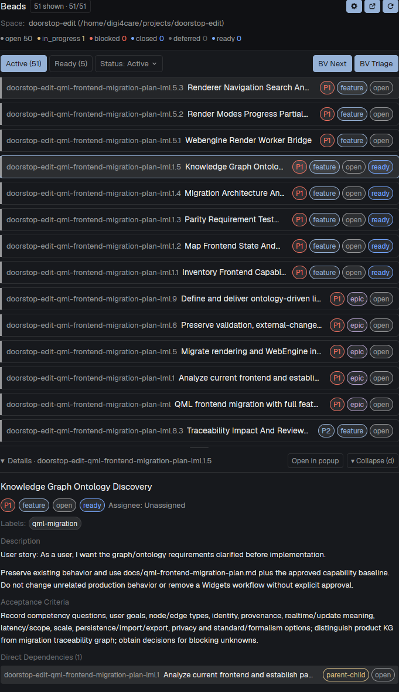

# Herdr Beads Desktop

A native read-only Herdr Desktop panel for beads_rust (`br`) and beads_viewer (`bv`), following the focused workspace and tab. It targets beads_rust, the Rust port, not the original Go `beads` (`bd`). It appears only where `br` can read an initialized Beads project and keeps issue browsing available when `bv` is absent.

## What you see

A 380 px right-side panel using the active Herdr theme:

1. **Header:** the Beads title, shown/total issue counts, current workspace and focused project path, and a **Refresh (r)** button.
2. **Controls:** **Active** and **Ready** filters, plus **BV Next** and **BV Triage** when `bv --version` succeeds. Otherwise a compact **BV unavailable** status appears.
3. **Issue list:** scrollable cards with issue ID, title, status, priority, issue type, and a ready badge where applicable.
4. **BV results:** a dismissible section with one Next recommendation or up to three Triage cards. Cards show available priority, score, and reasons and can select a loaded issue.
5. **Details:** a 230 px scrollable area with title, status, priority, type, assignee, labels, description, acceptance criteria, and direct dependencies.

No functional panel appears in an ordinary home directory, a remote space, or another context where `br` cannot read an initialized project. The mod hides its own layout block and shows it again after a successful `br` load.

## How it behaves

- **Active** shows non-closed issues returned by `br list`; **Ready** shows only IDs returned by `br ready`.
- Mouse selection and arrow keys move through issues; Enter loads details and `r` refreshes.
- Refresh reloads list and ready data on demand and prevents duplicate requests. Visible mode has no automatic issue polling.
- Focused workspace, tab, and terminal cwd determine the project. Switching either reloads data. Clicking the mod itself preserves the previous valid terminal context.
- Loading, empty, unavailable, and error states are explicit. A BV failure does not hide valid issue data.
- Hidden mode checks focused context once per second and probes `br` at most once every five seconds so the panel can reappear. The watcher stops on close.
- Issue status, priority, readiness, scores, and dependency counts come only from `br`/`bv`; the mod never invents progress or readiness.

## Built from

- `mods/beads-desktop/mod.json`: right placement, 380 px, focusable.
- `mods/beads-desktop/main.js`: a GPUI `View`, focused-context handling, sequential read-only `exec` calls, generation guards, BV availability checks, layout visibility, mouse/keyboard interaction, and theme rendering.
- `mods/beads-desktop/context.js`: pure focused workspace/tab/cwd resolution and actual-layout-hidden visibility decisions.
- `mods/beads-desktop/data.js`: pure parsers and filters for the CLI JSON contracts.
- `tests/context.test.js` and `tests/data.test.js`: 13 behavior tests using Node's built-in `node:test`.
- Commands: `br list --json --limit 200`, `br ready --json`, `br show <id> --json`, `br dep list <id> --json`, `bv --version`, `bv --robot-next`, and `bv --robot-triage`.
- Layout visibility: locate only `content.mod === "beads-desktop"` and call `layout.hide`/`layout.show` outside `render()`.

No external packages, shell strings, network calls, tracker writes, Git mutations, or bare `bv` invocation.

## Watch out

- `space.folder` can be stale or refer to another project; `focused().cwd` is authoritative. Include the focused tab ID in the context key.
- Preserve the previous valid context when the mod itself has focus and no terminal cwd is available.
- Run `br` reads sequentially to avoid auto-import/freshness races during concurrent tracker use.
- A hidden layout state survives hot reload; do not rely only on an in-memory `hiddenByMod` flag.
- Herdr does not let a docked mod remove its slot without layout commands. Never hide another node. If no own block is found, use a compact fallback.
- `herdr-app check` validates initial rendering, not later async states or interaction. Test workspace/tab changes and real data in the app.
- Current evidence covers workspace/tab loading and conditional visibility. Mouse issue selection and BV button interaction remain explicitly pending in `CHANGELOG.md`.

## Done when

- `npm test` passes all 13 behavior tests, including stale-folder, tab-switch, mod-focus, and hidden-layout recovery cases.
- `herdr-app check mods/beads-desktop` passes.
- A home directory hides the mod; an initialized local Beads project shows real issues.
- Two focused project contexts, including two tabs in one workspace, load their own issues without stale data.
- Details and BV results preserve read-only behavior and independent error states.
- `preview.png` is a real app screenshot, not a mockup.
